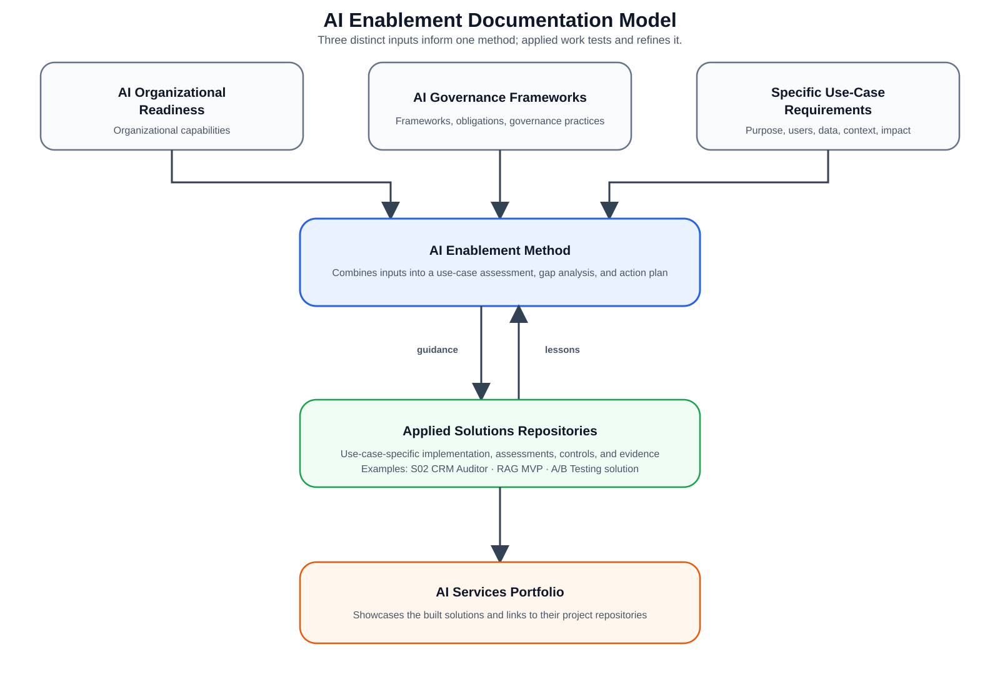

# Repository roles, interfaces, and feedback

This page is the authoritative guide to how the AI Enablement repositories and applied solution projects fit together. The AI Enablement Method connects the three inputs, while each repository remains authoritative for the material it owns.

## Repository responsibilities

| Repository or input | Owns | Provides to the method or reader |
|---|---|---|
| [AI Governance Frameworks](https://github.com/fit2grow-DataNinja/ai-governance-frameworks) | Source-grounded framework notes, legal and regulatory source records, interpretations, and reusable governance materials | Applicable obligations, governance outcomes, risk-management concepts, and source references |
| [AI Organizational Readiness](https://github.com/fit2grow-DataNinja/ai-organizational-readiness) | Reusable readiness dimensions, criteria, evidence expectations, and assessment guidance | A way to assess whether organizational capabilities meet the needs of a specific use case |
| **Specific use-case requirements** | Defined in each applied project record; not a separate central repository | The system purpose, users, data, operating context, autonomy, impacts, technical needs, and relevant external expectations |
| **AI Enablement Method** (this repository) | The repeatable assessment process, templates, decision logic, versioning, and feedback rules | A traceable assessment, gap analysis, action plan, and reasoned outcome for a use case |
| **Applied solution repositories** | Project implementation, project-specific assessment, decisions, controls, tests, evidence, limitations, and status | The authoritative record of what was built, evaluated, and evidenced for that solution |
| [AI Services Portfolio](https://github.com/fit2grow-DataNinja/ai-services-portfolio) | Cross-project presentation, business context, comparisons, and navigation | A concise showcase that links visitors to the detailed project records |

## How information moves

1. **Ground the assessment.** Use current, source-checked governance material and the readiness model. Define the use case in its own project context.
2. **Apply the method.** Record which governance sources and readiness criteria are relevant, why they apply, what evidence was reviewed, and what assumptions remain.
3. **Keep project evidence with the project.** The applied solution repository records the method version, source versions or dates, assessment, decisions, controls, tests, gaps, owners, and implementation status.
4. **Summarize for discovery.** The AI Services Portfolio presents the problem, solution, contribution, status, key evidence, limitations, and links. It does not replace the project record.

## Feedback and change control

The relationship is iterative, but project findings do not automatically become general requirements.

- A project lesson that suggests changing the **method** is submitted as a documented proposal in this repository, with the originating project and evidence linked.
- A lesson about **readiness dimensions or criteria** is proposed in the AI Organizational Readiness repository.
- A change to **framework interpretation or source-backed guidance** is reviewed and recorded in AI Governance Frameworks using its source-review process.
- The relevant repository owner reviews the proposal, records the rationale and disposition, and updates the canonical material only when supported.
- When the method changes, update its version or revision record. Existing project assessments retain the method version and source snapshot they actually used.
- The AI Services Portfolio is updated when a project’s public summary, status, evidence links, or limitations change.

## Minimum provenance in an applied assessment

Each assessment should identify:

- use case, scope, owner, review date, and open questions;
- AI Enablement Method version or commit;
- relevant governance sources and versions/dates checked;
- readiness criteria version or revision used;
- evidence links, assumptions, gaps, decisions, controls, and status;
- follow-up owner and review trigger.

## Current application status

The repositories define the intended architecture; the method and readiness materials are still being developed. Existing projects should not be described as having used the method unless a dated assessment says so. S02 predates this method; RAG is an in-progress learning project. Future use cases, including the A/B testing recreation, can apply a recorded method version when the method is ready.
